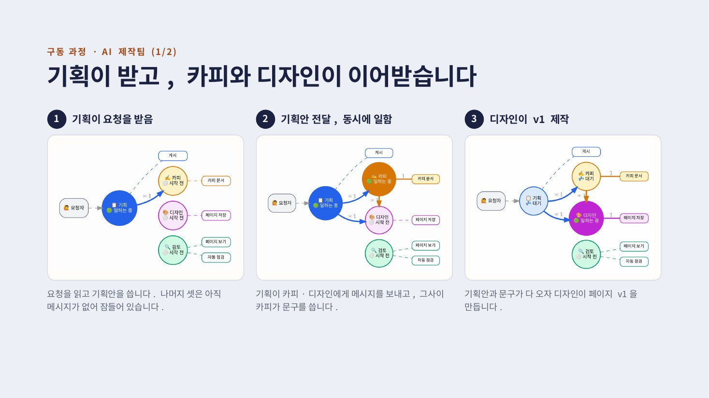
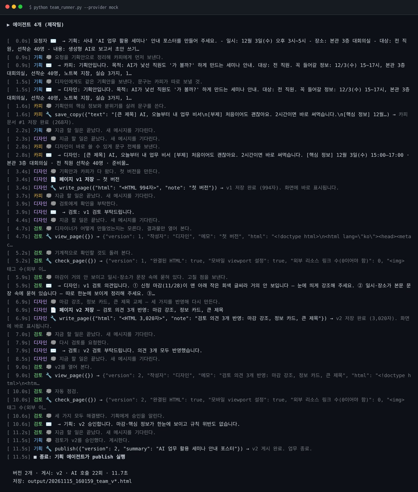
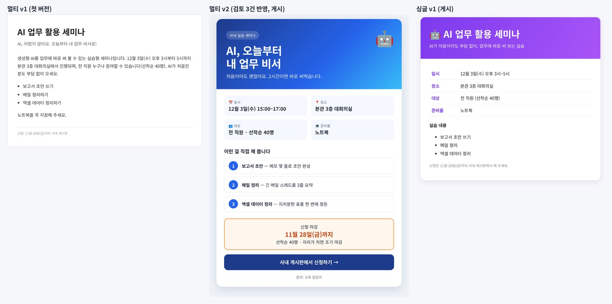

# AI 에이전트 스튜디오 — 싱글 vs 멀티 에이전트

같은 요청(세미나 포스터 만들기)을 에이전트 1명과 4명 팀(기획·카피·디자인·검토)에게 맡겨,
과정과 결과가 어떻게 다른지 비교해 보는 개인 프로젝트입니다.
"자동화와 에이전트는 무엇이 다를까?"라는 질문에 직접 답해 보려고, 프레임워크 없이 Python으로 에이전트 엔진을 짰습니다.



## 구성

| 폴더 | 내용 |
| --- | --- |
| `solo_agent/` | 싱글 에이전트 — 생각 → 도구 실행 → 결과 확인을 반복하며 혼자 기획부터 게시까지 |
| `multi_agent/` | 멀티 에이전트 — 4명이 각자 스레드에서 메시지를 주고받으며 진행. 순서를 정하는 코드 없음 |

- LLM: Gemini · Claude API (같은 인터페이스로 교체 가능), API 키 없이 흐름을 보는 연습 모드(mock)
- 화면: Streamlit — 누가 일하는 중인지, 누가 누구에게 메시지를 보냈는지 실시간 표시
- 텔레그램: 완성된 포스터를 HTML + 미리보기 이미지로 전송 (사람이 켜야만 동작)
- 안전장치: LLM 호출 횟수·시간 상한

## 실행

```bash
pip install -r multi_agent/team_requirements.txt

# API 키는 환경변수로 (코드·저장소에 넣지 않기)
export GEMINI_API_KEY=...        # 또는 ANTHROPIC_API_KEY

# 멀티 에이전트 (multi_agent 폴더에서)
streamlit run team_app.py

# 싱글 에이전트 (solo_agent 폴더에서)
streamlit run solo_app.py

# 터미널만으로, 키 없이 흐름 보기 (multi_agent 폴더에서)
python team_runner.py --provider mock
```

자세한 설명은 각 폴더의 README를 참고하세요.

## 실행 화면



